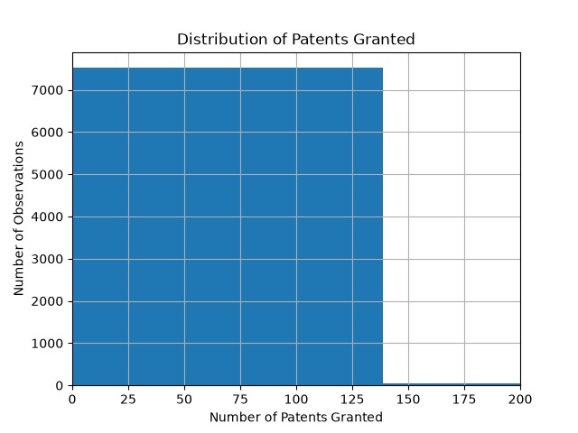
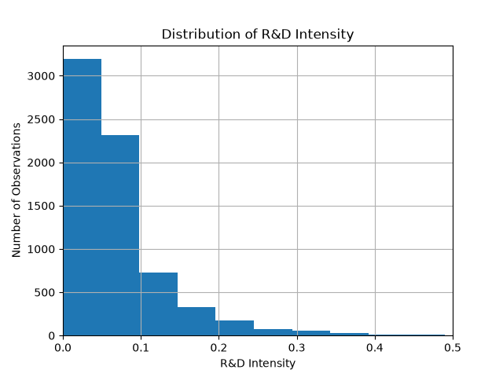
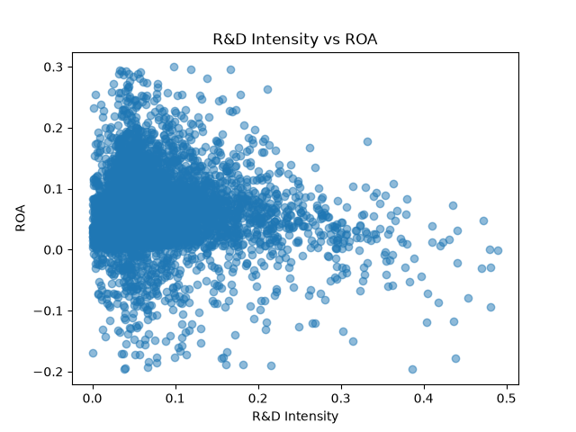
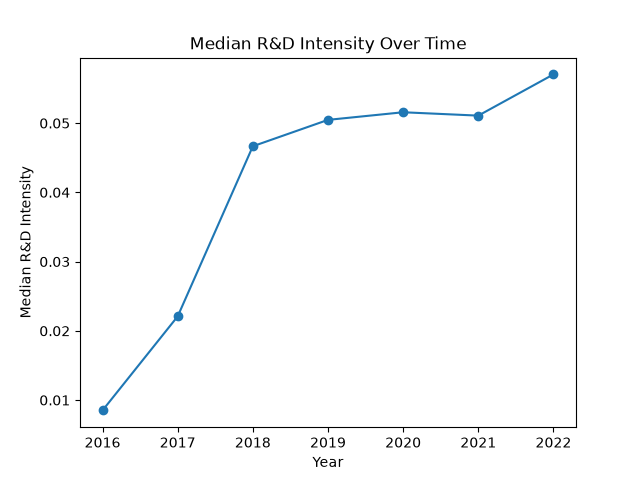
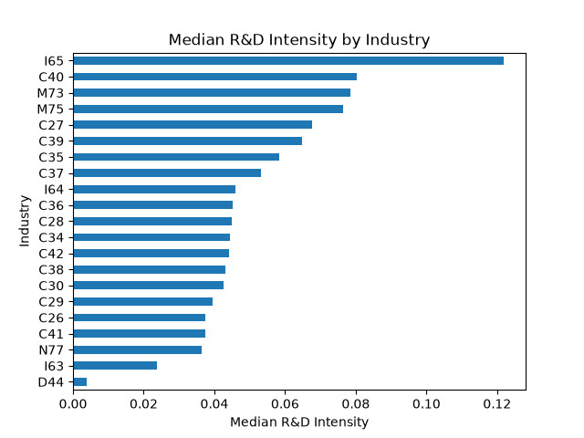
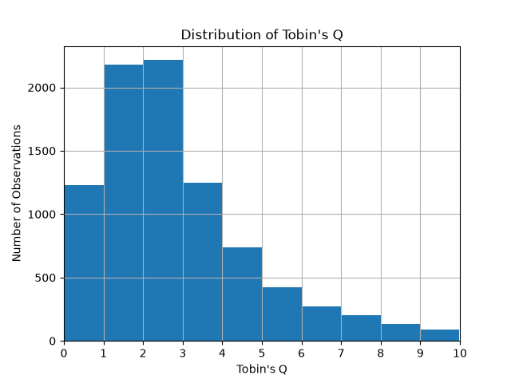
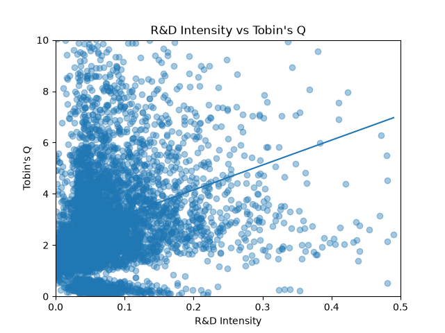

# Week 7 Data Analysis Findings

## 1. Dataset Overview

The dataset contains 8,972 observations and 12 variables, covering company-level observations from 2010 to 2022.

The dataset includes company information, financial variables, R&D expenditure, and patent grants.

## 2. Patent Distribution

The distribution of patent grants is highly right-skewed. Most observations have relatively low numbers of patents granted, while a small number of observations have very high patent counts.

The maximum number of patents granted is 1,389.

## 3. R&D Intensity Distribution

R&D intensity is highly right-skewed. Most observations have relatively low R&D intensity, while a small number of observations have extremely high values.

The median R&D intensity is approximately 5.17%. The maximum R&D intensity ratio is 41,693.79, indicating the presence of extreme observations.

For visualization, observations with R&D intensity above 50% are excluded from the chart, while the original data are retained.

## 4. R&D Intensity and ROA

The scatter plot shows a weak negative association between R&D intensity and ROA in the filtered visualization sample.

The correlation coefficient is approximately -0.109. This indicates that the linear relationship between the two variables is weak.

This result represents an association rather than a causal relationship.

## 5. R&D Intensity Over Time

Median R&D intensity generally increased from 2016 to 2022.

The most substantial increase occurred between 2016 and 2019. R&D intensity was relatively stable from 2019 to 2021 before increasing again in 2022.

R&D expenditure data are unavailable for all observations from 2010 to 2015. Therefore, R&D intensity cannot be calculated for these years, and the time-series analysis starts from 2016.

## 6. R&D Intensity by Industry

Median R&D intensity varies across industries.

Some industries have substantially higher median R&D intensity than others, suggesting that innovation investment patterns differ across industry groups.

## 7. Tobin's Q Distribution

Tobin's Q is calculated as:

Tobin's Q = (Market Value + Total Liabilities) / Total Assets

All 8,972 observations have valid Tobin's Q values.

The mean Tobin's Q is approximately 3.10, while the median is approximately 2.44. The maximum value is approximately 33.37.

The mean is higher than the median, indicating a right-skewed distribution with a small number of observations having relatively high Tobin's Q values.

For visualization, the chart focuses on observations with Tobin's Q below 10. The original data are retained.

## 8. R&D Intensity and Tobin's Q

A simple OLS regression was conducted to examine the linear association between R&D intensity and Tobin's Q.

ST and *ST observations were excluded, observations with missing values were removed, and observations with R&D intensity above 50% were excluded from the regression sample.

The final regression sample contains 6,903 observations.

The estimated coefficient on R&D intensity is 9.7131 and is statistically significant (p < 0.001). The R-squared is 0.062.

The positive coefficient indicates that higher R&D intensity is associated with higher Tobin's Q in the filtered sample. However, the relatively low R-squared indicates that R&D intensity alone explains only a limited proportion of the variation in Tobin's Q.

This result represents an association rather than a causal effect. Additional firm-level and time-related factors should therefore be considered in subsequent predictive modelling.

## 9. Potential Data Issues

### Missing R&D expenditure data

R&D expenditure data are unavailable for all observations from 2010 to 2015. Therefore, R&D intensity cannot be calculated for these years.

### Extreme R&D intensity values

R&D intensity contains several extreme observations. There are 67 observations with R&D intensity above 50%, including 38 observations above 100%.

The extreme values are mainly associated with observations where revenue is very low relative to R&D expenditure. These observations should be considered carefully in further analysis and modelling.

### Tobin's Q distribution

Tobin's Q is also right-skewed, with a maximum value of approximately 33.37 compared with a median of approximately 2.44.

These extreme values are retained in the original dataset but the visualization focuses on the range where observations are more concentrated.